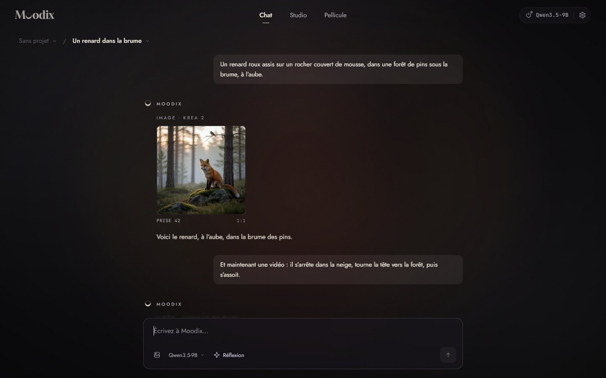
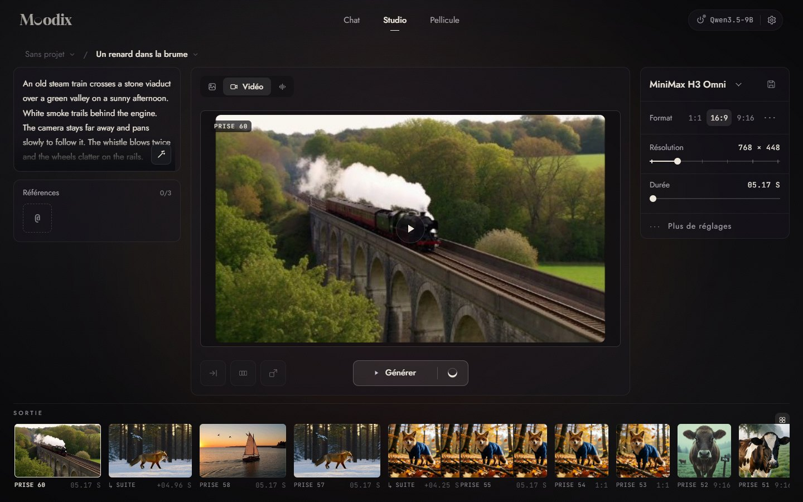
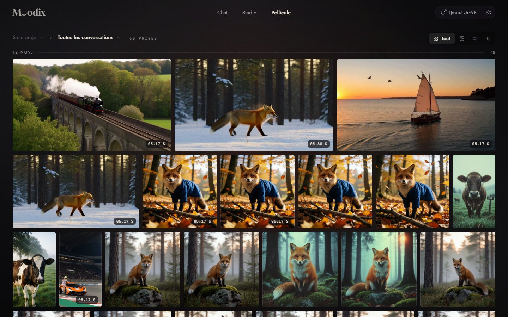

# Moodix

A local assistant that chats, looks at images, and creates images, videos, music and sound effects on your own computer. A language model talks with you, decides when a creation is useful and drives the generation engines through real tool calls. The assistant itself is called **Moodix AI**.



By default nothing you write or create leaves your computer: no remote API, no telemetry, no web assets. The application only asks GitHub for its own latest version and for the list of llama.cpp builds. You may choose a remote chat model instead (see [Remote chat model](#remote-chat-model-optional)); then, and only then, what you write is sent to that service. Generation always stays on your computer.

The interface runs in your browser and uses French labels; their names are quoted below to help you find the controls. A small Node.js server owns the language model and the generation worker; it has no npm dependency, except one optional library installed the first time you choose Claude.

## What it does

The top bar has three tabs, and the gear icon opens **Paramètres** (settings).

- **Chat**: talk with Moodix AI, attach images or videos, and let it create. Images are made at once; every video and every sound waits on a proposal card until you agree.
- **Studio**: create by hand. Choose **Image**, **Vidéo** or **Son**, write the prompt, add an image to modify, start, end and reference images, or a video and the character to put in it, set the format, resolution, duration, LoRAs and seed, then **Générer**. Each result joins the strip of takes at the bottom (**Sortie**), where a video can be continued (**Prolonger**) and an image modified (**Modifier**) or animated (**Animer**).
- **Pellicule**: every creation, by day, filtered by project, by conversation and by kind (images, videos, sounds).

A take, wherever it is shown, can also be upscaled (**Agrandir et affiner**) and a video given in-between frames (**Interpoler**).

<p>
  
  
</p>

Conversations can be grouped into projects; the project and the conversation are chosen on the line under the top bar (« Sans projet / Nouvelle conversation »), in the Chat and in the Studio alike. **Paramètres › Interface** sets the background, its grain and its lighting.

## Getting started

Requirements:

- **Node.js 22 or later** in PATH and a recent browser.
- A **llama-server** (llama.cpp) to run a local chat model: your own build, or the official one for your computer, which Moodix offers to install on the first launch (card « Avant le premier message ») and in **Paramètres › Mise à jour › Composants**. NVIDIA/CUDA is optional for chat: the model can run on the processor.
- For generation: Windows or Linux x64 with an NVIDIA graphics card for images and videos. Without one, these models are shown greyed with the reason. Real-ESRGAN upscaling, interpolation, music and sound effects also run on the processor; SeedVR2 upscaling needs the card. The first time generation is prepared, a private Python environment (several GB) is downloaded into `data/runtime/`; your system Python is left untouched.

Start the application:

- Windows: double-click **Lancer-Windows.cmd**.
- Linux: `sh lancer-linux.sh`.
- Either system: `node scripts/launch.mjs --open` (or `npm start`).

Open **http://127.0.0.1:8787** if the browser does not open by itself. Keep the launcher window open: closing it, pressing `Ctrl+C` or choosing **Fermer l’application** in **Paramètres › Application** stops the app, its model and its generation worker. Launching again reuses an up-to-date instance, or cleanly replaces an outdated idle one from the same folder.

## Chat model

Open **Paramètres › Moodix AI**:

- **Vos LLM** lists the local GGUF models found under `models/LLMs/` (one folder per model, whose name becomes its display name) and the remote providers. **Ajouter un LLM local** adds a model by path. A matching `mmproj` vision projector, in the folder of the model or in `models/vision/<name>/`, lets the model read images. Use a model and chat template that support **native tool calls**: a creation only starts from a real tool call, never from text that imitates one.
- **Consignes globales** (up to 16,000 characters): context and preferences given to the model at the start of each new chat.
- **Moteur et calcul**: the llama.cpp engine, **Contexte total** (what the model keeps in memory during a conversation), **Sortie maximale** (the length of a reply) and **Calcul** (the share of the model placed on the graphics card).

The engine starts with `--jinja`, offline. Some Qwen3.5 GGUF exports declare an MTP layer without its tensors; Moodix detects this and uses an in-memory metadata fix, or a compatibility copy in `data/model-cache` when needed. The original file is never modified.

### Remote chat model (optional)

**Paramètres › Moodix AI › Vos LLM** lists three providers under the local models. There you associate your account; the model and its reflection are chosen in the bar of the chat.

- **ChatGPT** · *Continuer avec ChatGPT*: your ChatGPT Plus or Pro plan, without an API key. This follows OpenAI's [ChatGPT plan usage for open-source and locally hosted apps](https://developers.openai.com/siwc/token-sharing-open-source): the sign-in page of OpenAI opens in your browser, Moodix registers itself in your account, and its usage counts against your plan (manage it in ChatGPT › Settings › Usage). Free ChatGPT accounts are not eligible.
- **Claude** · *Installer*, then *Associer une clé*: an API key of your [Claude Console](https://console.anthropic.com), paid per use. Anthropic does not let applications sign in with a Claude.ai account nor use Claude Pro or Max plans, so a key is the only way. *Installer* puts Anthropic's official library (`@anthropic-ai/sdk`, about 17 MB) into `node_modules/` with npm, at the version locked in `package-lock.json`.
- **OpenRouter** · *Se connecter*: an OpenRouter connection without copying a key, following OpenRouter's [OAuth PKCE flow](https://openrouter.ai/docs/guides/overview/auth/oauth). Once you accept, OpenRouter creates an API key of your account labelled « Moodix », which comes back to a page of Moodix on `localhost` and is kept on this computer. That key spends your OpenRouter credits when you choose a paid model; models ending in `:free` need none (OpenRouter limits them to a number of requests a day). Delete the key in your OpenRouter account (Keys) to revoke it: signing out only erases it from this computer.
- **Autre service (adresse)**, under the list: any server that speaks the OpenAI chat completions protocol, with presets for OpenAI, Mistral and Groq (by key), and for the local servers Ollama and LM Studio (which need no key). Fill in the address, the key if the service asks for one, and the exact model name; **Tester la connexion** asks the model one word. Tick **Ce modèle voit les images** when it reads images.

In the bar of the chat, two buttons stand beside the attachment button. The first shows the model: with a remote provider, it lists its models (with a search field when there are many). The second is its reflection: the efforts the chosen model takes (*Faible*, *Moyenne*, *Élevée*…), kept as your last choice; with a local model, *Avec réflexion* or *Sans réflexion*.

ChatGPT, Claude and OpenRouter are spoken to as large models (`lib/model-wording.mjs`): a consigne that says what Moodix is, tools described as contracts (`lib/tasks-capable.json`: a video is proposed at once, its card is where you agree), and the results of the tools reduced to facts. Local models and other services keep the wording written for a small model, unchanged to the character (`tests/model-wording.mjs`).

Choosing a provider chooses it for the chat; **Distant** then shows beside its name in the top bar (not for a server on this computer, such as Ollama or LM Studio). Your messages, the images you attach and the references shown to the model go to that provider; conversations, references and creations stay in this folder. Keys and ChatGPT tokens are kept in `data/` (`remote-llm-keys.json`, `chatgpt-account.json`), never sent back to the page nor written in a log. With a remote model the graphics card is left entirely to generation. Choosing a local model in the list brings the chat back to llama.cpp.

## Chat

- Enter sends, Shift+Enter inserts a new line. The local model starts with the application; a message sent meanwhile waits for it.
- Attach PNG/JPEG images or MP4/WebM videos with the button, by drag and drop or by pasting; up to 64 images per message. An attached file is kept as a reference of the project and named in the message (« #ref3 »), so you can point the assistant to it.
- A thin gauge under the message box shows the context already used by the conversation. It appears when you point at the box, and stays once the context is nearly full; hover it for details.

When Moodix AI creates:

1. the request is checked against the workflow. An image starts at once. A video or a sound is shown on a proposal card, where the prompt, inputs, duration, format, resolution and seed can be changed in place; it waits there until you press **Générer**, and **Annuler** drops it;
2. a local chat model and its projector are unloaded to free the graphics card;
3. the Python worker runs the job, then confirms that video memory was released;
4. the chat model is reloaded and the result appears in the chat, the Studio strip and the Pellicule.

Several images in one message (« fais 10 images de ce style », « trois variantes ») are one call: the assistant prepares every prompt at once (up to 20 images), and Moodix makes them one after another with the same inputs and settings. A series stops at an image that fails or that you refuse, and when you stop the message. A message makes at most 100 generations, a limit set by the server.

After a creation the assistant receives its settings, not its pixels, unless you ask it to look; **Paramètres › Génération** can also have it look at every image or every video. Originals are written to `output/image/`, `output/video/` and `output/son/`, under names that sort by date (`2026-11-17_14-32-05_krea-2_a3f9.png`); creations made by earlier versions stay in `output/` itself. Deleting a conversation takes its creations out of the Pellicule but never deletes these files.

## Generation

Generation is on by default (**Paramètres › Génération › Activer la génération locale**). Its private Python environment is prepared the first time it is needed, or from **Paramètres › Mise à jour › Composants › Vérifier l’environnement**; the progress is shown there and the chat stays available meanwhile. Two boxes of the same section decide whether what Moodix AI sets up in the Studio starts by itself or waits for **Générer**: images (off by default) and videos (on by default, once you have agreed in writing to what it proposed). A sound always waits.

Workflows shipped with Moodix:

| Workflow | Creates |
| --- | --- |
| Krea 2 | Images: photos, illustrations, edits of an existing image (default image model) |
| MOSS Image | Images with layouts and written text (posters) |
| LTX 2.5 | Videos with sound: from text, between a start and an end image, with reference subjects, or continuing a video |
| MiniMax H3 Omni | Videos of 5 to 15 seconds with synchronized sound: from text, keeping the subjects of one to three reference images, or continuing a video |
| Wan 2.1 SCAIL-2 | Replaces a person of a video with the character of an image, keeping the motion, framing, set and sound |
| Musique (ACE-Step 1.5 XL) | Songs with sung lyrics or instrumentals, 10 seconds to 10 minutes |
| Bruitages (MOSS-SoundEffect v2) | Sound effects and ambiences, 1 to 30 seconds |
| Upscale SeedVR2 | Image upscaling and restoration (default upscaler) |
| Upscale rapide (Real-ESRGAN ×4) | Quick image upscaling |
| Upscale vidéo (Real-ESRGAN ×2) | Video upscaling, keeping the sound |
| Interpoler (RIFE 4.26) | In-between frames: smoother motion or slow motion |

**One engine.** Every workflow runs on Moodix's own Python engine (`runner/`), **MOSS Image** included since 0.6.124: no other program has to run beside Moodix. See [runner/README.md](runner/README.md) for the engine.

**Models** are set in **Paramètres › Modèles**: one line a model, the version it uses, whether the assistant may choose it (its switch, under « Moodix AI »), its versions under the chevron, and **Réglages** for its page. Each model is a small JSON file (a workflow): the shipped ones live in `runner/workflows/` and come with every download and update; what you change of one is saved in `workflow/`, which updates never touch, and **Rétablir les réglages de Moodix** takes the shipped one back. The page of a model has three parts:

- **Proposé à Moodix AI** (on by default): the assistant may choose this model, from the sentence you write there (« Il le choisit pour »). It then writes the prompt and chooses what is part of a request: the size or the format, the length, a draft or a final, the denoise of an image to modify. Off, the model is still yours in the Studio.
- **Fichiers**: one line a file, with **Parcourir** and **Détecter** (the file found by itself in the models folder); where it comes from is under its « ? ».
- **Réglages**: one line a setting (steps, guidance, shift, frames a second…), at the value Moodix gives it. They are yours alone: the assistant never changes them, and you may change one for a single creation in the Studio. A value you changed says « Valeur de base » beside it, and **Remettre les valeurs de base** takes them all back. A LoRA you add is always on, off, or left to the assistant's choice.

## Models

Git ignores weights, and the app never moves them. For a shipped workflow whose files are missing, the app offers to download them from their publisher (Hugging Face, or GitHub for Real-ESRGAN): nothing is downloaded before you ask, and a license that sets conditions is shown first and must be accepted (« J’ai lu, télécharger »). Files behind a license gate need your own Hugging Face account and a read token (**Paramètres › Workflows › Hugging Face**), which stays on this computer. Every model keeps its own license, and some restrict commercial use or the countries where the model may be used (MiniMax H3 is not licensed in the European Union, the United Kingdom, South Korea and the United States): see the [table of model licenses](THIRD_PARTY_NOTICES.md#models). Each folder under `models/` contains a short placement guide.

| Folder | Contents |
| --- | --- |
| `models/LLMs/<name>/` | One chat GGUF per folder (the folder name becomes its display name) |
| `models/vision/<name>/` | Matching `mmproj` vision projector for the chat model |
| `models/diffusion_models/` | Image and video generation models |
| `models/text_encoders/` | Generation text encoders, and their tokenizer folders |
| `models/vae/` | Image, video and audio VAEs |
| `models/loras/` | LoRAs |
| `models/upscale_models/` | Image and video upscalers (Real-ESRGAN) |
| `models/latent_upscale_models/` | Latent upscalers (LTX 2.5) |
| `models/frame_interpolation/` | Frame interpolation models (RIFE) |
| `models/diffusers/` | Model folders (ACE-Step, MOSS-SoundEffect) |
| `models/clip_vision/`, `models/checkpoints/` | Other components some workflows need (SCAIL-2) |

The generation folders carry the names ComfyUI gives its own. **Paramètres › Modèles › Dossier des modèles** takes one path: leave it empty for this `models/` folder, or point it to the `models` folder of a ComfyUI, which is read the same way. A model that fixes no file for a component takes, in the folder of that kind, the file that fits it, whatever its name; a file chosen on the page of the model always comes first. Separate folders are only needed when a kind of file is kept elsewhere: **Paramètres › Génération › Dossiers à part** has a line for each kind, where **Détecter** takes the one of the models folder back.

## History and data

**Paramètres › Application › Préférences** decides whether conversations are kept (on by default). They are saved with their reasoning and compressed images under `history/`; turning this off stops new writes without deleting anything. Attached files are kept in `data/resources/`.

`data/generation-journal.jsonl` records each step of the recent generations of the built-in engine (time, video memory, failure): it is where to read why a generation stopped. **Paramètres › Application › Diagnostic** shows the state of the chat engine and its last messages.

## Updates

Moodix looks for a newer stable version at launch and when **Paramètres › Mise à jour** is opened. Installing it downloads the pinned source archive, backs up the replaced sources, restarts and restores the open conversation and your draft. `data/`, `history/`, `output/`, `workflow/`, models and Git metadata are preserved. **Composants**, in the same tab, lists the programs Moodix uses with their versions.

### Rescue update

If the update from the page fails, or the page does not open at all, update from the application folder instead. This command uses neither the page nor the server of the installed version, so a broken version cannot keep the next one from arriving:

- Windows: double-click **Mettre-a-jour-Windows.cmd**.
- Linux: `sh mettre-a-jour-linux.sh`.
- Either system: `node scripts/rescue-update.mjs`.

> En français : si la mise à jour depuis la page échoue, double-cliquez sur **Mettre-a-jour-Windows.cmd** dans le dossier de Moodix, puis gardez cette fenêtre ouverte : elle devient celle de l'application.

It downloads the latest version of `main` exactly as the page does (pinned commit, same size limits, same archive checks), then closes the running app if it is idle. If the app is busy, opened from another folder, or if another program holds the port, it says what to close and goes on as soon as the port is free; after 10 minutes it gives up without changing anything. The sources are then replaced with a backup, and the new version is started by its own launcher and must answer with its new version number; otherwise the previous sources are put back and started again. `data/`, `history/`, `output/`, `workflow/`, models and Git metadata are never touched, and nothing else is installed. The window then holds the application, like the launcher's: keep it open.

Options: `--port=<n>` (8787 by default), `--no-open` (no browser), `--reinstall` (installs the published version again when it is the installed one; an older version is never installed).

## Security

The server listens only on `127.0.0.1`. Control routes check host, origin and a session token. Remote image URLs are rejected. Only one generation runs at a time.

## Development

```sh
npm test            # Node tests (simulated engines, no GPU)
npm run check:ui    # goes through the interface in a headless Chromium browser

# Python engine tests, with the interpreter of the private environment
# (Linux: data/runtime/venv/bin/python)
data/runtime/venv/Scripts/python.exe -s -m unittest discover -s runner/tests
```

The Node suite uses simulated llama.cpp and generation workers; it checks behavior, not model quality or speed. `git config core.hooksPath .githooks` turns on the check made before each commit: the interface gone through (`scripts/check-ui.mjs`), and the proof that copies already installed can still take the update (`scripts/check-update.mjs`).

Two rules keep installed copies working. Never add `dependencies` to `package.json`: the copies already installed refuse such an update (an optional library goes in `optionalDependencies`). And every new file of `public/` must be listed in `staticFiles` of `server.mjs`, or the page cannot load it.

Code style: Prettier (`.prettierrc.json`) for new JavaScript and CSS files; never across the repository, since several files are not in its format and tests read them as text (`server.mjs`, `lib/history.mjs`, `public/app.js`, `public/project-navigation.mjs`, `public/assets-ui.mjs`). Python: `ruff format --config runner/pyproject.toml` on the files you touch.

## Troubleshooting

- **The chat model does not start:** **Paramètres › Application › Diagnostic** shows the engine's last messages. An unknown option or architecture usually means an outdated llama.cpp build: install the official one from **Paramètres › Mise à jour › Composants**.
- **Out of memory:** stop the model, reduce **Contexte total**, or lower **Calcul** to place less of the model on the graphics card.
- **A creation is not offered:** check that generation is enabled, its environment is ready, at least one model is ready in **Paramètres › Modèles**, and the chat model supports native tool calls.
- **MOSS Image unavailable:** one of its four files is missing (model, Qwen3.5 text encoder, its tokenizer folder, FLUX.2 VAE): **Paramètres › Modèles** offers the download, or says which file it could not read.
- **Port in use:** another instance may be using 8787.
- **The update fails:** run the [rescue update](#rescue-update) from the application folder.

## References and licensing

- [llama.cpp](https://github.com/ggml-org/llama.cpp) and its [server documentation](https://github.com/ggml-org/llama.cpp/tree/master/tools/server)
- [Source distribution notes](DISTRIBUTION.md) and [third-party components](THIRD_PARTY_NOTICES.md)

Moodix is licensed under the [PolyForm Noncommercial License 1.0.0](LICENSE): you may download, use, modify and share it for any noncommercial purpose. Commercial use requires separate permission. Engines, Python libraries, models and projectors are supplied separately and keep their own licenses. What you may do with a generated image, video or sound depends on the license of the model that made it, not on Moodix's: the [third-party components](THIRD_PARTY_NOTICES.md#models) list each one with its limits (revenue thresholds, excluded countries, mentions to show).
